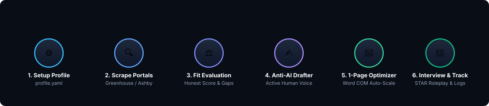

<div align="center">



<br/>


**A local, open-source job application engine. Works for any role. Runs on your machine. Your data stays yours.**

[Quick Start](#quick-start) · [Commands](#commands) · [Free Job Portals](#free-job-portals) · [Base CV Setup](#base-cv-setup) · [How It Works](#how-it-works) · [Contributing](#contributing)

</div>

---

## What CareerForge Does

You fill out one YAML profile. CareerForge handles the rest:

- Scans public job boards and ATS platforms automatically
- Builds a tailored, 1-page ATS-safe `.docx` and `.pdf` for each application
- Audits your CV and cover letter text against research-backed Anti-AI standards
- Runs 100% locally — no subscriptions, no cloud, no data leaving your machine

It works for any profession: data analyst, software engineer, designer, marketer, researcher, or anything else. The profile is yours to define.

---

## How It Works



1. Run `python cli.py setup` — wizard creates your `profile.yaml`
2. Place your base CV PDF in `cv/my_base_cv.pdf` (see [Base CV Setup](#base-cv-setup))
3. Run `python cli.py scrape` — scans Greenhouse, Ashby, and Remotive for matching roles
4. Run `python cli.py apply` — generates a tailored 1-page CV from your profile + job description
5. Run `python cli.py audit` — checks your writing against PNAS/ACL anti-AI standards

---

## Quick Start

### Requirements

- Python 3.9 or higher
- Windows: Microsoft Word installed (for 1-page PDF verification via COM)
- macOS / Linux: LibreOffice installed (headless fallback)

### Install

```bash
git clone https://github.com/YOUR_USERNAME/CareerForge.git
cd CareerForge
pip install -r requirements.txt
```

### Initialize Your Profile

```bash
python cli.py setup
```

The setup wizard walks you through your name, contact details, work experience, education, skills, and target roles. It saves everything to `profile.yaml` (which is excluded from git).

### Build Your First CV

```bash
python cli.py apply --role-tag "Data_Analyst"
```

Output goes to `output/YourName_Data_Analyst_CV.docx` and `.pdf`. Verified to exactly 1 page.

### Search for Jobs

```bash
python cli.py scrape --roles "Data Analyst" "BI Analyst" --limit 10
```

Scans Greenhouse, Ashby, and Remotive simultaneously. Filters by your preferred work mode (Remote by default).

---

## Commands

| Command | What It Does |
|---------|-------------|
| `python cli.py setup` | Interactive wizard to create `profile.yaml` |
| `python cli.py scrape` | Search job boards for roles matching your profile |
| `python cli.py scrape --roles "X" "Y"` | Search specific role keywords |
| `python cli.py scrape --include-senior` | Include senior / lead / director titles |
| `python cli.py scrape --save results.json` | Save job results to a JSON file |
| `python cli.py apply` | Build + verify a 1-page ATS CV |
| `python cli.py apply --role-tag "Engineer"` | Tag the output file with a role name |
| `python cli.py apply --out ./my_output` | Custom output directory |
| `python cli.py audit --file cover_letter.txt` | Run Anti-AI linguistic audit |

---

## Free Job Portals

CareerForge targets **remote jobs by default**. The scanner hits these sources automatically:

| Source | Type | CareerForge Support |
|--------|------|---------------------|
| **Greenhouse** | ATS Direct | Auto-scanned |
| **Ashby** | ATS Direct | Auto-scanned |
| **Remotive** | Remote Board | Auto-scanned |
| **We Work Remotely** | Remote Board | Manual |
| **Remote OK** | Remote Board | Manual |
| **Jobicy** | Remote Board | Manual |
| **Himalayas** | Remote Board | Manual |
| **Wellfound** | Startup Board | Manual |
| **Working Nomads** | Remote Board | Manual |
| **Hacker News Hiring** | Community | Manual |
| **LinkedIn Jobs** | Multi-purpose | Manual |

Full directory with URLs and guides: [`JOB_PLATFORMS.md`](JOB_PLATFORMS.md) (or [`scrapers/portal_list.md`](scrapers/portal_list.md))

### Switch From Remote to Hybrid or On-site

Edit `profile.yaml`:

```yaml
target_preferences:
  preferred_work_modes:
    - Remote       # keep this
    - Hybrid       # add for hybrid roles
    - On-site      # add for on-site roles
```

Re-run `python cli.py scrape` and the location filter updates automatically.

---

## Base CV Setup

Before running CareerForge, build a clean base CV using any free tool:

| Tool | URL | Notes |
|------|-----|-------|
| **FlowCV** | [flowcv.com](https://flowcv.com) | Clean ATS templates, free PDF export |
| **Reactive Resume** | [rxresu.me](https://rxresu.me) | 100% free and open-source |
| **Canva** | [canva.com/resumes](https://www.canva.com/resumes) | Design-friendly, free |
| **OpenResume** | [open-resume.com](https://www.open-resume.com) | ATS optimized, open-source |

Save the exported PDF to:

```
CareerForge/
└── cv/
    └── my_base_cv.pdf
```

CareerForge reads this as a reference when tailoring your CV. It never modifies the original. The `cv/` folder is in `.gitignore` — your personal files stay private.

Full instructions: [`cv/README.md`](cv/README.md)

---

## Profile Setup

Your `profile.yaml` controls everything. After running `python cli.py setup`, it looks like:

```yaml
personal:
  full_name: "Jane Smith"
  email: "jane@example.com"
  phone: "+1 555-0101"
  location: "New York, USA"
  linkedin: "linkedin.com/in/janesmith"
  github: "github.com/janesmith"

target_preferences:
  target_roles:
    - "Data Analyst"
    - "Business Intelligence Analyst"
  preferred_work_modes:
    - Remote
  base_cv_path: "cv/my_base_cv.pdf"

experience:
  - title: "Data Analyst"
    company: "Acme Corp"
    duration: "Jan 2023 – Present"
    location: "Remote"
    bullets:
      - "Built Power BI dashboards tracking 12 KPIs across 5 departments"
      - "Wrote SQL queries processing 50,000+ records monthly"
```

Full template: [`templates/profile.template.yaml`](templates/profile.template.yaml)

---

## Anti-AI Writing Standards

CareerForge includes a linguistic audit engine built from peer-reviewed research:

- Kobak et al. (*Science Advances*, 2024) — detects AI vocabulary inflation
- Reinhart et al. (*PNAS*, 2025) — catches abstract nominalization and participial suffix abuse
- Juzek & Ward (*ACL*, 2025) — flags RLHF-forced formality patterns

Run an audit on any text file:

```bash
python cli.py audit --file my_cover_letter.txt
```

The engine checks for banned terms (`delve`, `leverage`, `seamless`, `pivotal`, etc.), copula inflation, sentence burstiness, and participial clause abuse.

Full standards reference: [`rules/anti_ai_standards.md`](rules/anti_ai_standards.md)

---

## Project Structure

```
CareerForge/
├── assets/
│   ├── hero-banner.svg          # Visual banner
│   └── workflow-route.svg       # Workflow diagram
├── core/
│   ├── cv_builder.py            # Universal CV generator (python-docx)
│   ├── page_optimizer.py        # Word COM 1-page enforcer
│   ├── anti_ai_engine.py        # PNAS/ACL linguistic audit engine
│   ├── profile_loader.py        # YAML profile reader + validator
│   └── link_embedder.py         # Hyperlink helper for docx
├── scrapers/
│   ├── greenhouse_scanner.py    # Greenhouse public API scanner
│   ├── ashby_scanner.py         # Ashby public API scanner
│   ├── remotive_scanner.py      # Remotive public API scanner
│   ├── board_registry.py        # 70+ company slugs (Greenhouse + Ashby)
│   ├── work_mode_config.py      # Remote / Hybrid / On-site filter
│   └── portal_list.md           # Full curated free job portal directory
├── templates/
│   └── profile.template.yaml    # Sample profile for any role
├── rules/
│   └── anti_ai_standards.md     # Research-backed writing standards
├── cv/
│   └── README.md                # Instructions for base CV placement
├── cli.py                       # Main CLI entry point
├── setup_wizard.py              # Interactive profile setup wizard
├── requirements.txt             # Python dependencies
├── SETUP.md                     # Full installation guide
├── AGENTS.md                    # AI tool compatibility notes
├── CONTRIBUTING.md              # How to add scanners and features
└── .gitignore                   # Excludes profile.yaml, cv/, output/
```

---

## Privacy

CareerForge runs entirely on your machine.

- `profile.yaml` — excluded from git
- `cv/` folder — excluded from git
- `output/` folder — excluded from git

No data is sent anywhere. No accounts. No API keys required for core functionality.

---

## Requirements

```
python-docx>=0.8.11
pyyaml>=6.0
requests>=2.31.0
pywin32>=306        # Windows only, for Word COM PDF verification
```

Install: `pip install -r requirements.txt`

---

## Contributing

Contributions are welcome. See [`CONTRIBUTING.md`](CONTRIBUTING.md) for how to add a new job portal scanner, improve the CV builder, or extend the Anti-AI engine.

---

## License

MIT License. See [`LICENSE`](LICENSE).
