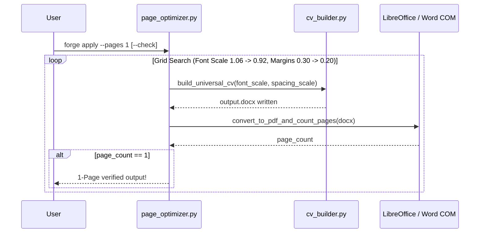
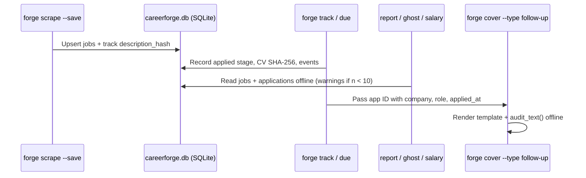

# CareerForge System Architecture

CareerForge is a modular, local-first application suite composed of five cooperating layers:
1. **Discovery Layer:** Public ATS scrapers (`Greenhouse`, `Ashby`, `Lever`, `Remotive`) and offline Google search dork URL generation (`forge dorks`).
2. **Matching & Eligibility Layer:** Skill ontology matching (`skills.yaml`), heuristic remote geo-restriction detection (`eligibility_rules.yaml`), and knapsack CV bullet selection with `--diff` breakdowns.
3. **Document Generation & Parser Check Layer:** Single-page `.docx` / `.pdf` builder (`LibreOffice` headless cross-platform default, `Word COM` on Windows), Anti-AI style audit (`anti_ai_rules.yaml`), and offline PDF/DOCX parser fragility diagnostics (`forge ats-sim`).
4. **Local Tracking & Analytics Layer:** Stdlib SQLite database (`careerforge.db` via `platformdirs`), Textual Kanban TUI (`careerforge[tui]`), cumulative funnel conversion reports (`forge report`), heuristic stale-job scoring (`forge ghost`), and disclosed compensation percentiles (`forge salary`).
5. **Interview & Outreach Preparation Layer:** Honest `TODO: fill in` STAR story bank (`stories.yaml` + bundled role question banks) and Anti-AI-audited outreach templates (`<<FILL: ...>>` markers + `--app` integration).

---

## System Component Diagram

```mermaid
graph TD
    User([User CLI / forge]) --> CLI[careerforge/cli.py]

    subgraph Data & Local Storage
        Profile[(profile.yaml)]
        SQLite[(careerforge.db<br/>SQLite v2)]
        Stories[(stories.yaml)]
        Ontology[(skills.yaml &<br/>eligibility_rules.yaml)]
        AuditRules[(anti_ai_rules.yaml)]
        Questions[(questions/*.yaml)]
        Templates[(templates/*.txt)]
    end

    subgraph Matching, Prep & Analytics
        Matcher[matcher.py &<br/>eligibility.py]
        Tailor[tailor_engine.py]
        Store[store.py & tui.py]
        Analytics[reporter.py, ghost.py,<br/>salary.py]
        Prep[interview.py &<br/>cover.py]
        Auditor[anti_ai_engine.py]
    end

    subgraph Document & PDF Pipeline
        Optimizer[page_optimizer.py]
        CVBuilder[cv_builder.py]
        AtsSim[ats_sim.py]
        LibreOffice[LibreOffice Headless]
        WordCOM[Windows Word COM]
    end

    subgraph Public Scrapers
        BaseScraper[BaseScraper ABC]
        GH[Greenhouse]
        Ashby[Ashby]
        Lever[Lever]
        Remotive[Remotive]
    end

    CLI --> Matcher
    Matcher --> Profile
    Matcher --> Ontology
    CLI --> Tailor
    Tailor --> Optimizer
    Optimizer --> CVBuilder
    Optimizer --> LibreOffice
    Optimizer --> WordCOM
    CLI --> AtsSim
    CLI --> Auditor
    Auditor --> AuditRules

    CLI --> Store
    Store --> SQLite
    CLI --> Analytics
    Analytics --> SQLite
    CLI --> Prep
    Prep --> Stories
    Prep --> Questions
    Prep --> Templates
    Prep --> Auditor

    CLI --> BaseScraper
    BaseScraper --> GH
    BaseScraper --> Ashby
    BaseScraper --> Lever
    BaseScraper --> Remotive
    CLI --> Dorks[dorks.py - offline URLs]
```

---

## Execution Flows

### 1. The 1-Page Document Auto-Fitting Loop


### 2. Local SQLite Tracking & Offline Preparation

