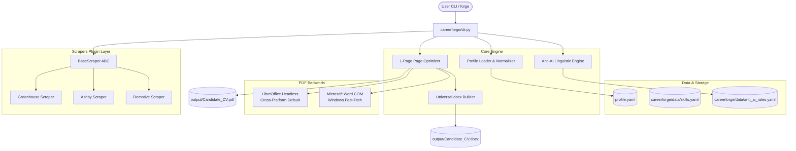
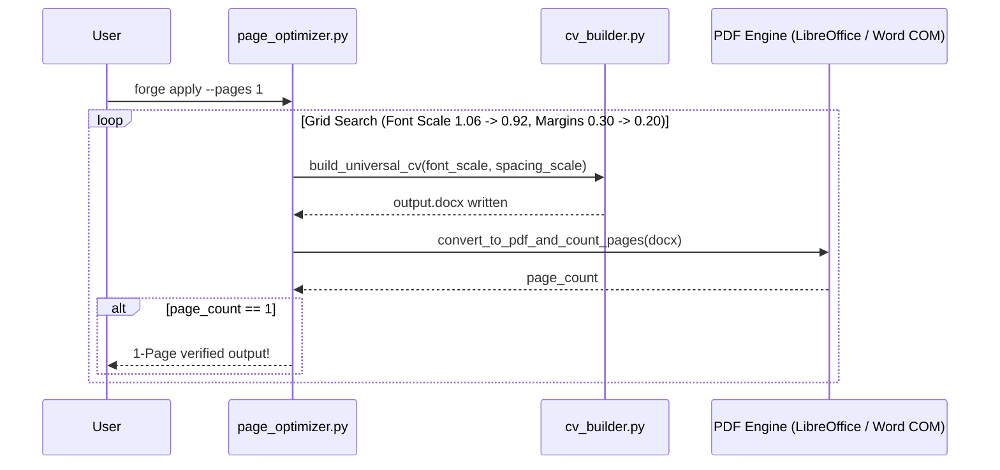
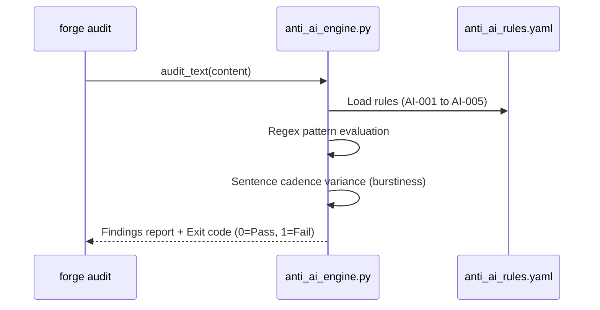

# CareerForge System Architecture

CareerForge is designed as a modular, local-first engine composed of three core subsystems:
1. **The Ingestion & Normalization Layer:** Loads user profiles and scrapes public job boards.
2. **The Verification & Audit Layer:** Enforces 1-page document constraints and linguistic compliance.
3. **The Document Generation Layer:** Produces ATS-safe `.docx` and verified `.pdf` output.

---

## 🏛️ System Component Diagram

---

## 🔄 Execution Flow

### 1. The 1-Page Document Auto-Fitting Loop

### 2. The Anti-AI Linguistic Audit Pipeline

